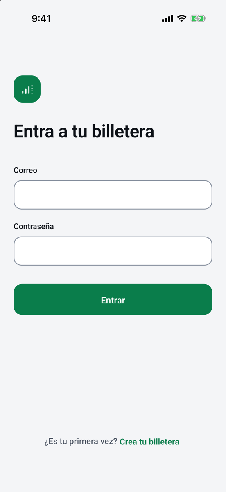
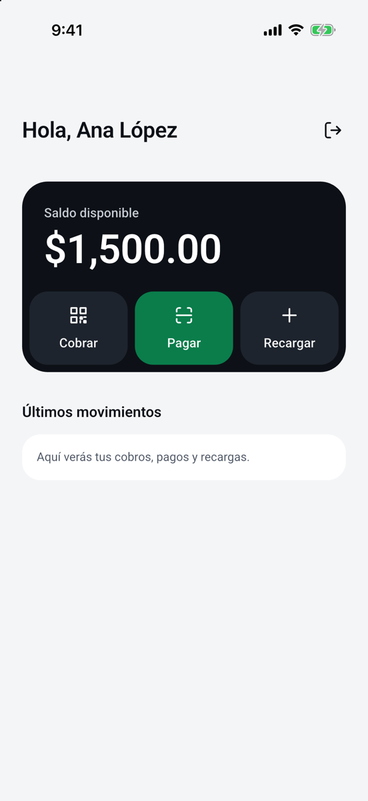

# NoSignal Pay

A simulated digital wallet for paying between phones with QR codes. One phone shows a payment
request as a QR code, the other scans it, checks the amount and who is charging, and confirms.

It is a two-person university project. **All money is simulated.** Offline payments (paying with
no signal, which gives the project its name) are planned for later milestones.

<p align="center">
  
  &nbsp;&nbsp;
  
</p>

## How it works

- **App** (`app/`): Flutter, with `provider` for state and `dio` for HTTP.
- **API** (`api/`): FastAPI and SQLAlchemy on PostgreSQL 17, with Alembic migrations.
- Balances come from a double-entry ledger: every transaction has entries that add up to zero, and
  nothing in the ledger is ever updated or deleted.
- Amounts are integer cents everywhere, never floating point.
- Every request that moves money needs an `Idempotency-Key` header, so retrying a payment never
  charges twice.
- The QR code holds only `NSP:1:REQ:<uuid>`: no amount and no personal data. The phone asks the
  server for the details before paying.

## Running it

You need Docker and Flutter 3.50.

### API

```bash
cp .env.example .env                           # then set JWT_SECRET (see the comments in the file)
docker compose up -d --build                   # PostgreSQL + API on http://localhost:8000
docker compose exec api alembic upgrade head   # create the tables
```

Check it with `curl http://localhost:8000/api/v1/health`. The interactive API docs are at
http://localhost:8000/docs.

### App

```bash
cd app
flutter pub get
flutter run --dart-define=API_BASE_URL=http://localhost:8000          # iPhone simulator
flutter run --dart-define=API_BASE_URL=http://10.0.2.2:8000           # Android emulator
flutter run --dart-define=API_BASE_URL=http://<laptop-ip>:8000        # physical phone
```

A physical phone must be on the same Wi-Fi network as the laptop. Simulators have no camera, so the
scan screen also has a field to paste the code.

## Tests

```bash
docker compose exec api pytest          # API tests, against a real PostgreSQL database
docker compose exec api ruff check .    # lint
cd app && flutter analyze && flutter test
```

CI runs all of these on pull requests and on pushes to `main` and `develop`.

## Project layout

```text
api/        FastAPI app (routers, services, models, schemas), Alembic migrations and tests
app/        Flutter app (screens, widgets, providers, ApiClient)
docs/       Screenshots
.github/    CI workflow
```

## License

[MIT](LICENSE)
